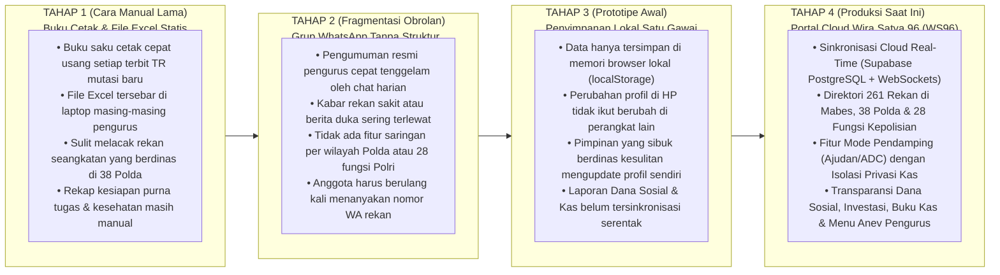
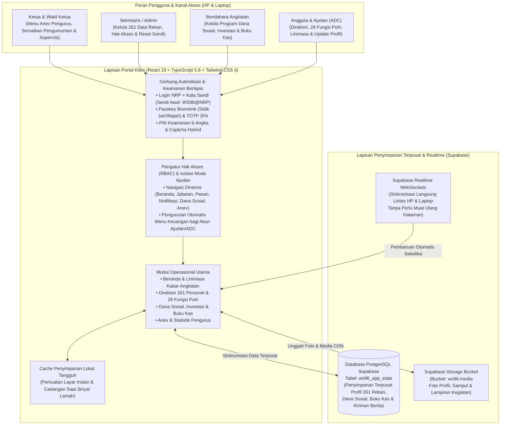

# Wira Satya 96 (WS96) — Powered by Paguyuban Alumni Akpol 1996 (*Batalyon Wira Satya*)

> 🌐 **Pilihan Bahasa / Language:** [**🇮🇩 Bahasa Indonesia (Aktif)**](README.id.md) &nbsp;|&nbsp; [**🇬🇧 English Version**](README.md)

[%20v2.5-991B1B.svg?style=flat-square)](https://wirasatya96.vercel.app)
[-1E40AF.svg?style=flat-square)](#-kisah-evolusi-dari-grup-chat--spreadsheet-statis-menuju-tata-kelola-digital-terpadu)
[](https://www.typescriptlang.org/)
[](https://tailwindcss.com/)
[](https://supabase.com/)
[](#1-direktori-264-personel-pemetaan-38-polda-28-fungsi-kepolisian--kompipleton)
[](#4-autentikasi-biometrik-fido2--webauthn-passkey--keamanan-multi-faktor)
[](LICENSE.md)
[-0A66C2.svg?style=flat-square&logo=linkedin&logoColor=white)](https://www.linkedin.com/in/omeko42/)

**Wira Satya 96 (WS96)** adalah portal **Buku Saku Digital**, direktori pemetaan penugasan & *Tour of Duty* nasional, dasbor analisis & evaluasi (*Anev*) 6 sub-tab, **Bursa Lowongan Kerja Putra-Putri Leting**, serta sistem transparansi **Dana Sosial & Buku Kas** berbasis *cloud real-time* yang dirancang dan dibangun khusus untuk **Paguyuban Alumni Akademi Kepolisian (Akpol) Tahun 1996 — Batalyon Wira Satya**.

Dirancang untuk mendukung mobilitas tinggi para **Perwira Tinggi (Pati) & Perwira Menengah (Pamen) Polri**, jajaran **Pengurus Paguyuban** (*Ketua, Wakil Ketua, Sekretaris, Bendahara*), serta para **Ajudan / Pendamping (ADC)**, **Wira Satya 96 (WS96)** menyatukan **264 profil personel** (**250 Aktif**, **1 Purna Tugas**, **1 PTDH**, dan **12 Almarhum / In Memoriam**, termasuk 3 akun simulasi `AKUN CONTOH_1..3`) di seluruh **Mabes Polri**, **38 Polda Jajaran**, **Luar Struktur** (*Kementerian/Lembaga*), **28 Fungsi Kepolisian (*Tour of Duty*)**, serta struktur **Kompi A–D & Pleton 1–4** ke dalam satu portal terpadu yang nyaman diakses melalui layar HP maupun komputer.

---

## 🚀 Kisah Evolusi: Dari Grup Chat & Spreadsheet Statis Menuju Tata Kelola Digital Terpadu

Platform ini dibangun untuk menjawab berbagai kendala nyata dalam komunikasi internal, pelacakan mutasi jabatan rekan seangkatan, hingga pengelolaan dana sosial pada paguyuban perwira aktif di seluruh Indonesia:



### Mengapa Transformasi **Wira Satya 96 (WS96)** Sangat Krusial?
1. **Kemudahan Mencari Kontak & Posisi Rekan di 38 Polda & 28 Fungsi Polri (*Tour of Duty*)**: Saat seorang anggota bertugas ke suatu daerah atau kementerian, Bapak/Ibu dapat langsung menyaring **261 rekan seangkatan** berdasarkan **Mabes Polri**, **38 Polda Jajaran**, **Luar Struktur** (*BNN, BIN, KPK, Kementerian/Lembaga*), maupun **28 Fungsi Kepolisian** (*Wasum, Rena, Ops, Lemdiklat, Reserse, Intelkam, Harkam, Brimob, Lantas, dll.*), lengkap dengan tombol pintas **WhatsApp** sekali sentuh dan **Obrolan Cepat**.
2. **Pembagian Wewenang Sesuai Struktur Kepengurusan (*Ketua, Sekretaris, Bendahara & Ajudan/ADC*)**: Menyelaraskan hak akses aplikasi dengan struktur organisasi **Paguyuban Wira Satya 96**:
   - **Ketua & Wakil Ketua (*Pimpinan Paguyuban*)**: Mengakses menu khusus **Anev & Statistik Pengurus** (*pemantauan kondisi kesehatan rekan, kesiapan hunian purna tugas, katalog usaha anggota, sebaran 38 Polda, serta pendidikan putra-putri*), menyematkan pengumuman penting di Beranda, serta memantau Dana Sosial & Kas.
   - **Sekretaris / Admin (*Pengelola Data & Akun*)**: Mengelola pembaruan **261 data personel**, mengatur jabatan kepengurusan, memantau keamanan akun, serta membantu *reset* kata sandi anggota yang lupa.
   - **Bendahara (*Pengelola Keuangan & Dana Sosial*)**: Dilengkapi tombol kelola khusus (`+ Milestone`, `+ Investasi`, `+ Buku Kas`, `Kategori`, dan `Unduh CSV/Excel`) untuk mencatat **Dana Sosial** (*Santunan Anak Yatim, Bantuan Rekan Sakit, Tali Asih Duka Cita, Baksos*) serta **Dana Investasi**.
   - **Ajudan / ADC (*Mode Pendamping*)**: Memungkinkan perwira yang sibuk berdinas mendelegasikan pembaruan foto profil dan riwayat jabatan kepada Ajudan kepercayaan (`WS96@<NRP_ADC>`), namun **akun Ajudan otomatis terkunci dari menu laporan keuangan (`Dana Sosial & Kas`)**.
3. **Kenyamanan Tampilan HP (*Mobile-First*) & Keberlanjutan Tali Asih Keluarga Besar**:
   - **Nyaman Digulir Satu Tangan di Layar HP**: Kartu informasi di halaman Beranda (*Atensi Kesehatan* & *Dana Sosial*) otomatis tampil ringkas berupa judul yang dapat disentuh untuk membuka detailnya, serta diakhiri kartu semboyan `#SELALUBAHAGIA` dan identitas resmi `BATALYON WIRA SATYA 1996` di bagian paling bawah.
   - **Menjaga Silaturahmi Keluarga Rekan Almarhum**: Menyimpan data keluarga, pemantauan beasiswa putra-putri (*Anak Yatim*), serta tombol WhatsApp yang otomatis terhubung ke nomor Istri/Wali keluarga bagi rekan yang telah mendahului (*Almarhum*).

---

## 🏗️ Arsitektur Sistem & Sinkronisasi Cloud Real-Time



> 📚 **Dokumentasi Teknis & Tata Kelola Lengkap**:
> - [**`ARCHITECTURE.md`**](ARCHITECTURE.md) — Catatan Keputusan Arsitektur Rekayasa (*Architecture Decision Records / ADR 001–005 — Bilingual*)
> - [**`CHANGELOG.md`**](CHANGELOG.md) — Riwayat Evolusi & Rilis Platform (*Tahap 1–3 hingga WS96 v2.0 — Bilingual*)
> - [**`CONTRIBUTING.md`**](CONTRIBUTING.md) — Pedoman Tata Kelola, Sanitasi Data & Kontribusi (*Bilingual*)
> - [**`LICENSE.md`**](LICENSE.md) — Lisensi Kedinasan & Paguyuban (WS96), NDA, SLA & Kebijakan Keamanan Terpadu (*Bilingual*)
> - [**`SECURITY.md`**](SECURITY.md) — Kebijakan Audit Keamanan Repositori Publik & Verifikasi *Zero-Secret* (*Bilingual*)
> - [**`CITATION.cff`**](CITATION.cff) — Metadata Sitasi Resmi Teknis & Portofolio

---

## 🗄️ 4 Klaster Fungsional Basis Data & Penyimpanan Terpadu

| Klaster Fungsional | Struktur Data Utama & Skala | Implementasi Rekayasa Utama |
| :--- | :--- | :--- |
| **Klaster 1: Direktori Personel & Riwayat Jabatan (*Tour of Duty*)** | `akpol1996Alumni.ts` (**261 Perwira**), `jabatanHistory`, `satker`, `polda` (**38 Polda + Mabes + Luar Struktur**), `fungsiPolri` (**28 Fungsi**) | Pengurutan berjenjang berdasarkan status kedinasan (`AKTIF` → `PURNA_TUGAS` → `PTDH` → `ALMARHUM`), jenjang pangkat (*Komjen/Irjen/Brigjen/Kombes*), dan level Satker; fitur pintar rekomendasi otomatis **Rekan Satu Wilayah**. |
| **Klaster 2: Buku Kas Ganda (*Dana Sosial & Dana Investasi*)** | `socialMilestones` (**4 Program Utama**), `investmentAssets`, `kasTransactions` (`SOSIAL` & `INVESTASI`), `financialCategories` | Pemisahan tegas antara donasi sukarela (*Santunan Anak Yatim, Besuk Rekan Sakit, Tali Asih Duka Cita, Baksos*) dan aset investasi paguyuban; dilengkapi fitur unduh laporan **CSV (Excel) ber-BOM UTF-8** sekali klik. |
| **Klaster 3: Mesin Anev Pengurus & Kesejahteraan Keluarga** | `kondisiKesehatan`, `statusRumahPensiun`, `usahaPensiun`, `keluarga` (`pasangan` & `anak`), `waliKontak` | Rekapitulasi *real-time* pada 5 dimensi Anev (*Kesehatan, Hunian Purna Tugas, Katalog Usaha, Sebaran 38 Wilayah, Pendidikan & Pensiun*) serta pengalihan otomatis tombol WA ke Istri/Wali bagi rekan *Almarhum*. |
| **Klaster 4: Sinkronisasi Cloud, Linimasa & Keamanan MFA** | `ws96_app_state` (**Supabase PostgreSQL**), `ws96-media` (**Supabase Storage**), `securityLogs`, `trustedDevices`, `adcList` | Sinkronisasi *cloud* nirserver (`cloudSync.ts`) dengan **Supabase Realtime WebSockets**; autentikasi khusus **Ajudan / Pendamping (`ADC`)** (`WS96@<NRP_ADC>`) dengan pembatasan akses keuangan. |

---

## ⚡ Kapabilitas Rekayasa Utama

### 1. Direktori 264 Personel, Pemetaan 38 Polda, 28 Fungsi Kepolisian & Kompi/Pleton
- **Pemetaan Penugasan Nasional Menyeluruh**: Memetakan seluruh **264 profil Batalyon Wira Satya** (**250 Aktif**, **1 Purna Tugas**, **1 PTDH**, **12 Almarhum**) di **Mabes Polri**, **38 Polda Jajaran se-Indonesia**, penugasan **Luar Struktur (*BNN, BIN, KPK, Kementerian/Lembaga*)**, serta formasi **Kompi A–D & Pleton 1–4**.
- **28 Kategori Fungsi Kepolisian (*Tour of Duty*) & Formulir Mandiri `Data Diri` 5 Kategori**: Saringan interaktif di seluruh 28 fungsi dilengkapi formulir mandiri **Data Diri 5 Kategori** (*1. Kedinasan & Identitas*, *2. Domisili & Keluarga Inti*, *3. Purna Tugas & Usaha*, *4. Kesehatan, Fisik & Asuransi*, *5. Aparel & Perlengkapan*) dengan fitur simpan parsial per sub-bagian, input multi-jabatan (`+ Tambah Jabatan`), dan daftar merek asuransi (`+ Tambah Asuransi`).

### 2. Transparansi Keuangan Dua Kamar (*Dana Sosial & Dana Investasi*) & Ekspor Excel
- **Ringkasan 4 Kartu Keuangan Utama**: Menampilkan capaian **Dana Sosial (4 Program Utama)**, portofolio **Dana Investasi**, **Saldo Buku Kas**, serta **Arus Buku Kas** (*Kas Masuk & Kas Keluar*).
- **Otorisasi Pengelolaan Khusus Bendahara & Pengurus**: Seluruh anggota dapat memantau transparansi kas secara terbuka, sementara tombol pencatatan transaksi (`+ Program`, `+ Investasi`, `+ Buku Kas`, `Kategori`, dan `CSV`) hanya muncul pada akun **Bendahara**, **Ketua/Wakil**, dan **Admin**.

### 3. Dasbor Anev & Statistik Eksekutif 6 Sub-Tab, Bursa Loker & Keluarga Almarhum
- **Rekapitulasi 6 Dimensi Strategis (`Anev & Statistik`)**: Tersedia untuk memantau secara *real-time*:
  1. **Kesehatan**: Daftar rekan yang membutuhkan perhatian medis, pemulihan rawat inap, atau rujukan spesialis lengkap dengan golongan darah dan ukuran aparel.
  2. **Hunian & Purna Tugas**: Kesiapan tempat tinggal BUP 60 Tahun (*Milik Sendiri* vs *Sewa/Kontrak* beserta rincian biaya sewa tahunan & kota tujuan pensiun).
  3. **Katalog Usaha & Lowongan**: Direktori **Usaha Pribadi** anggota dan **Usaha Bersama Leting** yang terintegrasi dengan **Bursa Lowongan Kerja Putra-Putri Leting & Almarhum**.
  4. **Sebaran Wilayah & Kompi/Pleton**: Kekuatan personel per **Kompi A–D**, **Pleton 1–4**, **Mabes Polri**, dan **38 Polda** (beserta penanda wilayah perlu penjangkauan).
  5. **Pendidikan & Pensiun**: Rekapitulasi putra-putri yang masih menempuh pendidikan sekolah/kuliah, beban biaya pendidikan tinggi (`> Rp 25 Juta/thn`), serta kesiapan dana pensiun.
  6. **Keluarga Almarhum (12 In Memoriam)**: Direktori khusus 12 rekan yang telah mendahului lengkap dengan nama Istri/Ahli Waris, tombol pintas **`WA Keluarga`**, serta status kesiapan kerja/pendidikan putra-putri (*Siap Kerja* / *Pelajar*).

### 4. Autentikasi Biometrik FIDO2 / WebAuthn Passkey & Keamanan Multi-Faktor
- **Kemudahan Masuk Pertama Kali dengan Sandi Awal (`WS96@<NRP>`)**: Seluruh akun anggota dan Ajudan yang terdaftar telah disiapkan dengan sandi bawaan `WS96@<NRP>` menggunakan 8 digit NRP masing-masing, yang selanjutnya dapat diganti dengan kata sandi pribadi.
- **Pertahanan Keamanan Berlapis (*Multi-Factor Authentication*)**: Mendukung login cepat dengan **Sidik Jari / Wajah (WebAuthn Passkey)** di HP maupun laptop, **TOTP 2FA (Google/Microsoft Authenticator)**, **PIN Keamanan 6-Angka**, **OTP Email**, fitur **Kelola & Cabut Akses Gawai Terpercaya**, serta **Captcha Hybrid (Proof-of-Work SHA-256 + SVG)**.

### 5. Mode Pendamping (*Ajudan / ADC*) & Tampilan Ringkas Khusus Layar HP
- **Delegasi Aman bagi Perwira Sibuk (*Fitur Ajudan*)**: Anggota dapat mendaftarkan NRP dan nama Ajudan/ADC kepercayaannya di profil. Ketika Ajudan masuk menggunakan `WS96@<NRP_ADC>`, aplikasi menampilkan penanda **`Mode Pendamping (Ajudan)`** — mengizinkan pembaruan foto dan riwayat jabatan pimpinan, namun **mengunci seluruh akses ke menu `Dana Sosial & Kas`**.
- **Tata Letak Beranda Responsif di HP**: Saat dibuka dari layar HP, kartu informasi seperti *Atensi Kesehatan* dan *Dana Sosial* ditampilkan ringkas berupa *header* yang dapat disentuh untuk membuka detailnya, dengan urutan bawah yang selalu menjaga kartu `#SELALUBAHAGIA` dan identitas `BATALYON WIRA SATYA 1996`.

---

## 📂 Struktur Lengkap Repositori

```text
├── src/                                      # Kode Sumber Utama Portal Next.js 14 App Router
│   ├── app/                                  # Halaman App Router & Endpoint REST API Server
│   │   ├── api/                              # Route API Server (auth, finance, members, messages, posts, users)
│   │   ├── login/page.tsx                    # Halaman Login, Pendaftaran & Bantuan Lupa Kata Sandi
│   │   ├── page.tsx                          # Pengendali Utama 6 Menu (Beranda, Jabatan, Pesan, Notifikasi, Dana Sosial, Anev)
│   │   ├── layout.tsx & globals.css          # Tata Letak Induk, Tipografi & Aturan Responsif Layar HP/PC
│   ├── components/                           # Bundel Modul Komponen Antarmuka (21 Komponen)
│   │   ├── AdminVerificationModal.tsx        # Konsol Kelola Akun, Verifikasi & Log Audit (Sekretaris/Superadmin)
│   │   ├── BendaharaPortal.tsx               # Modul Transparansi Dana Sosial, Investasi & Buku Kas Dua Kamar
│   │   ├── BukuSaku.tsx                      # Direktori Buku Saku Digital & Pencarian Multi-Kriteria
│   │   ├── ExecutiveDashboard.tsx            # Dasbor 5 Tab Anev & Statistik Pengurus Paguyuban
│   │   ├── LinkedInJobsPage.tsx              # Pemetaan 28 Fungsi Kepolisian (Tour of Duty) & 38 Polda
│   │   ├── LinkedInMessagingPage.tsx         # Pusat Pesan Internal & Pintasan Langsung WhatsApp
│   │   ├── LinkedInProfileView.tsx           # Tampilan Biodata Lengkap, Riwayat Jabatan & Rekan Satu Wilayah
│   │   ├── SecuritySettingsModal.tsx         # Pengaturan Passkey Biometrik, TOTP 2FA, PIN & Kelola Gawai
│   │   └── Navbar.tsx & WSLogo.tsx           # Navigasi Atas Dinamis Sesuai Peran & Penanda Mode Pendamping (ADC)
│   ├── data/                                 # Basis Data Terverifikasi & Struktur Organisasi Polri
│   │   ├── akpol1996Alumni.ts                # Direktori Terverifikasi 261 Alumni Akpol 1996 (38 Polda & 28 Fungsi)
│   │   ├── polriStructure.ts & polriJabatan.ts # Taksonomi Mabes Polri, 38 Polda & Luar Struktur
│   │   └── mockUsers.ts & mockFinance.ts     # Matriks Hak Akses (RBAC) & Struktur Awal Buku Kas
│   └── lib/                                  # Mesin Penyimpanan Cloud, Cache & Keamanan
│       ├── serverStore.ts                    # Penyimpanan Multi-Koleksi & Rekonsiliasi Peran Pengurus
│       ├── supabaseCloud.ts                  # Mesin Sinkronisasi 9 Tabel PostgreSQL Supabase Cloud
│       ├── offlineSyncEngine.ts              # Cache Lokal Tangguh & Antrean Sinkronisasi Luring
│       └── redisCache.ts & mediaSecurity.ts  # Akselerasi Cache Server & Validasi Keamanan Media
├── backend/                                  # Layanan Mikro Mandiri Express.js + PostgreSQL + MinIO S3
│   ├── src/index.ts                          # Bootstrap Server REST API Express (:5000)
│   ├── src/config/db.ts & minio.ts           # Koneksi Pool PostgreSQL 16 & Klien MinIO S3 Presigned URL
│   └── src/routes/                           # Rute Modular Express (auth, finance, jabatan, kesehatan, members, posts)
├── database/                                 # Skema Basis Data Relasional & Skrip Setup Cloud
│   ├── init.sql                              # Skema DDL Lengkap PostgreSQL 16 On-Premise
│   └── supabase_setup.sql                    # Skema 9 Tabel Terstruktur Supabase Cloud (ws96_members, ws96_users, dll.)
├── docker-compose.yml                        # Orkestrasi Multi-Container (Frontend, Backend, Postgres 16, MinIO S3)
├── README.md                                 # Dokumentasi Utama (Edisi Bahasa Inggris / Default)
├── README.id.md                              # Dokumentasi Utama (Edisi Bahasa Indonesia Resmi)
├── ARCHITECTURE.md                           # Catatan Keputusan Arsitektur Rekayasa (ADR 001–005 — Bilingual)
├── CHANGELOG.md                              # Riwayat Evolusi & Rilis Platform (Bilingual)
├── CONTRIBUTING.md                           # Pedoman Tata Kelola & Kontribusi (Bilingual)
├── CITATION.cff                              # Metadata Sitasi Resmi Teknis & Portofolio
├── LICENSE.md                                # Lisensi Kedinasan & Paguyuban (WS96), NDA, SLA & Kebijakan Keamanan
├── SECURITY.md                               # Kebijakan Audit Keamanan Repositori Publik & Zero-Secret
└── .env.example                              # Template Variabel Lingkungan (Sanitized)
```

---

## 🛠️ Tumpukan Teknologi (*Technology Stack*)

| Lapisan | Teknologi yang Digunakan |
| :--- | :--- |
| **Portal Frontend & App Router (`wirasatya96`)** | Next.js 14 (App Router & API Routes), React 18/19, TypeScript 5, Tailwind CSS, Lucide React Icons (`lucide-react`), Desain Responsif *Mobile-First* |
| **Layanan Backend & Container (`backend/`)** | Node.js, Express.js, TypeScript, PostgreSQL 16 (`pg` Pool), MinIO S3 (`@aws-sdk/client-s3`), Docker & Docker Compose |
| **Penyimpanan Cloud & Sinkronisasi (`src/lib/`)** | Supabase Multi-Table PostgreSQL (`ws96_members`, `ws96_users`, `ws96_posts`, `ws96_transactions`, `ws96_milestones`, `ws96_assets`), Offline Sync Engine |
| **Keamanan & Verifikasi Multi-Faktor** | WebAuthn / FIDO2 Hardware Passkey (`navigator.credentials`), RFC 6238 TOTP 2FA, PIN Keamanan 6-Angka, Audit & Cabut Akses Gawai Terpercaya |
| **Infrastruktur & Hosting** | Vercel Edge Network (`https://wirasatya96.vercel.app`) & Dukungan Self-Hosted Docker Compose |

---

## 🔒 Keamanan, Lisensi, NDA & SLA Tata Kelola

- **Lisensi Paguyuban, NDA, SLA & Kebijakan Keamanan Terpadu ([`LICENSE.md`](LICENSE.md))**: Dirancang dan dikembangkan oleh **Eko Agung (`@omeko42`)** untuk tata kelola komunikasi, direktori penugasan, dan transparansi dana sosial **Paguyuban Alumni Akpol 1996 — Batalyon Wira Satya (WS96)**. Menyatukan perlindungan hak cipta, klausul **Perjanjian Kerahasiaan (NDA)**, komitmen **SLA Operasional (`99,9% Uptime` & Sinkronisasi Cloud Real-Time)**, serta **Arsitektur Keamanan Multi-Faktor** (**Seluruh Hak Dilindungi Undang-Undang — Dilarang keras memperjualbelikan ulang atau memalsukan atribut paguyuban/institusi**).
- **Kepatuhan Regulasi**: Direkayasa sesuai amanat **UU No. 27 Tahun 2022 tentang Perlindungan Data Pribadi (UU PDP)** serta **UU ITE**.
- **Kontrol Versi Bebas Rahasia (*Zero-Secret Version Control*)**: Seluruh file di dalam repositori ini telah diaudit dan disanitasi untuk menjamin tidak adanya kebocoran kunci rahasia server (`service_role`), kata sandi basis data, sandi/PIN pribadi anggota, maupun dokumen paparan internal (`.pptx`/`.pdf`). Lihat [`.env.example`](.env.example), [`SECURITY.md`](SECURITY.md), dan [`LICENSE.md`](LICENSE.md).

---

## 👨‍💻 Perancang & Arsitek Utama Sistem

- **Eko Agung** - [GitHub (`@omeko42`)](https://github.com/omeko42) &nbsp;|&nbsp; [LinkedIn (`in/omeko42`)](https://www.linkedin.com/in/omeko42/)  
  *Full-Stack Engineer & System Architect*  
  *Pengembang Utama **Wira Satya 96 (WS96) — Paguyuban Alumni Akpol 1996***
