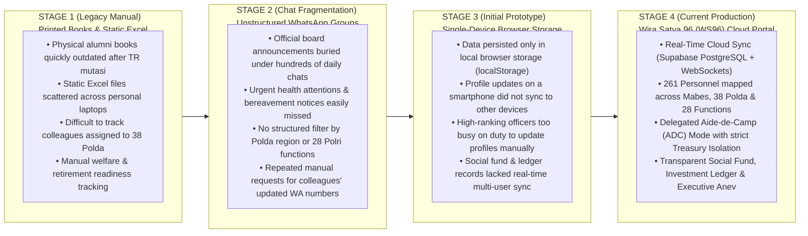
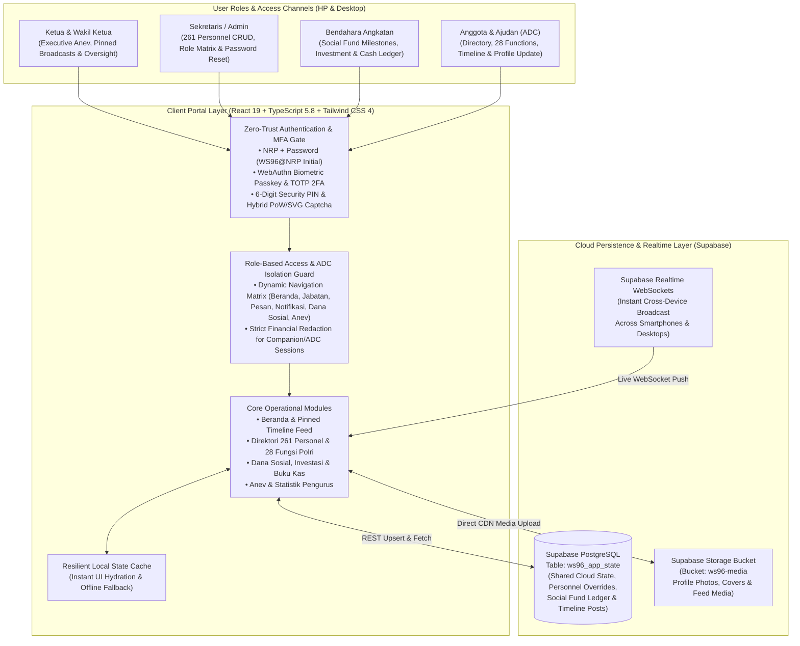

# Wira Satya 96 (WS96) — Powered by Paguyuban Alumni Akpol 1996 (*Batalyon Wira Satya*)

> 🌐 **Language / Pilihan Bahasa:** [**🇬🇧 English (Active)**](README.md) &nbsp;|&nbsp; [**🇮🇩 Bahasa Indonesia (Edisi Resmi)**](README.id.md)

[%20v2.5-991B1B.svg?style=flat-square)](https://wirasatya96.vercel.app)
[-1E40AF.svg?style=flat-square)](#-the-evolution-story-from-fragmented-chats--static-spreadsheets-to-sovereign-digital-governance)
[](https://www.typescriptlang.org/)
[](https://tailwindcss.com/)
[](https://supabase.com/)
[](#1-264-personnel-directory-38-polda-jurisdiction-mapping-28-polri-functions--kompipleton)
[](#4-fido2--webauthn-biometric-passkey--multi-factor-security-suite)
[%20%7C%20NDA%20%7C%20SLA-B91C1C.svg?style=flat-square)](LICENSE.md)
[-0A66C2.svg?style=flat-square&logo=linkedin&logoColor=white)](https://www.linkedin.com/in/omeko42/)

**Wira Satya 96 (WS96)** is a cloud-synchronized digital pocketbook (*Buku Saku Digital*), nationwide assignment & *Tour of Duty* directory, 6-sub-tab executive welfare analytics (*Anev*), family job board (*Bursa Lowongan Kerja Putra-Putri Leting*), and transparent social fund governance portal engineered for **Paguyuban Alumni Akademi Kepolisian (Akpol) Tahun 1996 — Batalyon Wira Satya**.

Designed for high-mobility senior police officers (*Perwira Tinggi [Pati] & Perwira Menengah [Pamen] Polri*), executive board administrators (*Ketua, Wakil Ketua, Sekretaris, Bendahara*), and authorized aides-de-camp (*Ajudan / ADC*), **Wira Satya 96 (WS96)** unifies **264 personnel profiles** (**250 Active**, **1 Retired/Purna Tugas**, **1 PTDH**, and **12 In Memoriam/Almarhum**, including 3 end-to-end simulation sample accounts `AKUN CONTOH_1..3`) across **Mabes Polri**, **38 Regional Police Commands (*Polda*)**, **External Ministries/Agencies (*Luar Struktur*)**, **28 Police Functional Categories (*Tour of Duty*)**, and **Kompi A–D / Pleton 1–4** into a single real-time portal accessible seamlessly from both smartphones and desktop browsers.

---

## 🚀 The Evolution Story: From Fragmented Chats & Static Spreadsheets to Sovereign Digital Governance

This portal was engineered to solve real operational communication, directory tracking, and social fund administration bottlenecks experienced by alumni associations of active senior officers across Indonesia:



### Why the Transformation to **Wira Satya 96 (WS96)** Matters
1. **Instant Colleague Discovery Across 38 Polda & 28 Polri Functions (*Tour of Duty*)**: When an alumnus travels on official duty to a province or ministry, they can immediately filter the **261-officer directory** by **Mabes Polri**, **38 Polda Jajaran**, **Luar Struktur** (*BNN, BIN, KPK, Ministries*), or any of the **28 Police Functional Categories** (*Wasum, Rena, Ops, Lemdiklat, Reserse, Intelkam, Harkam, Brimob, Lantas, etc.*), complete with one-tap **WhatsApp** and internal **Quick Chat** actions.
2. **Role-Scoped Executive Governance (*Ketua, Sekretaris, Bendahara & Ajudan/ADC*)**: Aligns digital permissions with the real organizational structure of **Paguyuban Wira Satya 96**:
   - **Ketua & Wakil Ketua (*Executive Leadership*)**: Full access to **Executive Anev & Statistics** (*health attention monitoring, retirement housing readiness, alumni business catalog, 38-Polda distribution, and children's education*), pinned timeline broadcasts, and financial oversight.
   - **Sekretaris / Admin (*Directory & Account Custodian*)**: Full management of **261 alumni records**, role & permission assignment, account security monitoring, and one-click password reset assistance.
   - **Bendahara (*Treasury & Social Fund Custodian*)**: Dedicated CRUD controls (`+ Milestone`, `+ Investasi`, `+ Buku Kas`, `Kategori`, and `CSV Export`) managing **Dana Sosial** (*Orphan Scholarship, Medical Attention, Bereavement, Baksos*) and **Dana Investasi**.
   - **Ajudan / ADC (*Mode Pendamping*)**: Allows busy senior officers to delegate profile photo and career history updates to their trusted Aide-de-Camp (`WS96@<NRP_ADC>`) while **strictly locking out access to financial ledgers (`Dana Sosial & Kas`)**.
3. **Mobile-First Ergonomics & Family Welfare Continuity (*Tali Asih Keluarga Besar*)**:
   - **Thumb-Friendly Mobile Layout**: Engineered with collapsible accordion cards on mobile screens (*Atensi Kesehatan* & *Dana Sosial* display compact headers that expand on tap) and a structured bottom-anchored battalion identity card (`#SELALUBAHAGIA — Guyub, Peduli, & Mengabdi Sejak 1996`).
   - **Honoring Fallen Colleagues (*Almarhum*)**: Preserves family records, scholarship tracking for orphaned children (*Anak Yatim*), and direct WhatsApp contact buttons connected to the surviving spouse/guardian (*Istri/Wali*) so brotherhood ties never break.

---

## 🏗️ Real Cloud-Synchronized System Architecture



> 📚 **Deep-Dive Documentation & Governance Blueprints**:
> - [**`ARCHITECTURE.md`**](ARCHITECTURE.md) — System Architecture & Engineering Decision Records (*ADRs 001–005 — Bilingual*)
> - [**`CHANGELOG.md`**](CHANGELOG.md) — Platform Evolution & Release History (*Stage 1–3 to WS96 v2.0 — Bilingual*)
> - [**`CONTRIBUTING.md`**](CONTRIBUTING.md) — Governance, Data Sanitization & Contribution Guidelines (*Bilingual*)
> - [**`LICENSE.md`**](LICENSE.md) — Unified Institutional License (WS96), NDA, SLA & Security Policy (*Bilingual*)
> - [**`SECURITY.md`**](SECURITY.md) — Public Repository Security Audit & Zero-Secret Verification Policy (*Bilingual*)
> - [**`CITATION.cff`**](CITATION.cff) — Official Technical & Portfolio Citation Metadata

---

## 🗄️ 4 High-Availability Data & State Domains

| Functional Domain | Core Data Structures & Scale | Key Engineering Implementation |
| :--- | :--- | :--- |
| **Domain 1: Personnel Directory & Career History (*Tour of Duty*)** | `akpol1996Alumni.ts` (**261 Officers**), `jabatanHistory`, `satker`, `polda` (**38 Polda + Mabes + Luar Struktur**), `fungsiPolri` (**28 Functions**) | Hierarchical sorting by service status (`AKTIF` → `PURNA_TUGAS` → `PTDH` → `ALMARHUM`), rank tier (*Komjen/Irjen/Brigjen/Kombes*), and Satker level; automatic same-jurisdiction colleague recommendations (*Rekan Satu Wilayah*). |
| **Domain 2: Dual-Fund Financial & Investment Ledger** | `socialMilestones` (**4 Core Programs**), `investmentAssets`, `kasTransactions` (`SOSIAL` & `INVESTASI`), `financialCategories` | Strict separation between voluntary solidarity campaigns (*Santunan Anak Yatim, Besuk Rekan Sakit, Tali Asih Duka Cita, Baksos*) and productive battalion investments; one-click **UTF-8 BOM CSV (Excel)** export for audit transparency. |
| **Domain 3: Executive Anev & Family Welfare Telemetry** | `kondisiKesehatan`, `statusRumahPensiun`, `usahaPensiun`, `keluarga` (`pasangan` & `anak`), `waliKontak` | Real-time executive aggregation across 5 Anev dimensions (*Kesehatan, Hunian Purna Tugas, Katalog Usaha, Sebaran 38 Wilayah, Pendidikan & Pensiun*) plus automated guardian WhatsApp routing for fallen colleagues (*Almarhum*). |
| **Domain 4: Cloud Synchronization, Social Feed & MFA Security** | `ws96_app_state` (**Supabase PostgreSQL**), `ws96-media` (**Supabase Storage**), `securityLogs`, `trustedDevices`, `adcList` | Debounced cloud state synchronization (`cloudSync.ts`) paired with **Supabase Realtime WebSockets**; delegated **Aide-de-Camp (`ADC`)** authentication (`WS96@<NRP_ADC>`) with strict treasury lockout. |

---

## ⚡ Key Production Capabilities

### 1. 264-Personnel Directory, 38-Polda Jurisdiction Mapping, 28 Polri Functions & Kompi/Pleton
- **Comprehensive Assignment Taxonomy**: Maps **264 Batalyon Wira Satya profiles** (**250 Active**, **1 Retired**, **1 PTDH**, **12 In Memoriam**) across **Mabes Polri**, **38 Regional Police Commands (*Polda*)**, **External Institutions (*Luar Struktur*: BNN, BIN, KPK, Ministries/Agencies)**, and battalion formation (**Kompi A–D & Pleton 1–4**).
- **28 Police Functional Categories (*Tour of Duty*) & 5-Category Self-Service FormWizard (`Data Diri`)**: Interactive filtering across all 28 functions alongside a 5-category self-service profile wizard (*1. Kedinasan & Identitas*, *2. Domisili & Keluarga Inti*, *3. Purna Tugas & Usaha*, *4. Kesehatan, Fisik & Asuransi*, *5. Aparel & Perlengkapan*) featuring per-section partial save, repeatable multi-position history (`+ Tambah Jabatan`), and repeatable health insurance brand lists (`+ Tambah Asuransi`).

### 2. Dual-Fund Financial Transparency (*Dana Sosial & Dana Investasi*) & CSV Audit Export
- **4-Card Executive Financial Summary**: Displays live metrics for **Dana Sosial (4 Core Programs)**, **Dana Investasi**, **Saldo Buku Kas**, and **Arus Buku Kas** (*Kas Masuk vs. Kas Keluar*).
- **Role-Gated Treasury Management**: All alumni enjoy full read transparency over social fund progress and cash book entries, while mutation controls (`+ Program`, `+ Investasi`, `+ Buku Kas`, `Kategori`, and `CSV Export`) are restricted to **Bendahara**, **Ketua/Wakil**, and **Admin**.

### 3. 6-Sub-Tab Executive Anev, Family Job Board & In Memoriam Welfare Telemetry
- **6-Dimensional Executive Dashboard (`Anev & Statistik`)**: Real-time monitoring across 6 strategic sub-tabs:
  1. **Kesehatan**: Officers requiring medical attention, hospitalization support, or specialist referrals, complete with blood type and apparel sizes.
  2. **Hunian & Purna Tugas**: BUP 60-year retirement housing readiness (*Milik Sendiri* vs *Sewa/Kontrak* with annual rent cost & target retirement city).
  3. **Katalog Usaha & Lowongan**: Directory of personal businesses (*Usaha Pribadi*) and joint cohort enterprises (*Usaha Bersama Leting*) featuring a dedicated **Family Job Board (*Bursa Lowongan Kerja Putra-Putri Leting & Almarhum*)**.
  4. **Sebaran Wilayah & Kompi/Pleton**: Live strength distribution across **Kompi A–D**, **Pleton 1–4**, **Mabes Polri**, and **38 Polda** (including regional outreach indicators).
  5. **Pendidikan & Pensiun**: Tracking of dependent children in school/university, high-tuition education loads (`> Rp 25M/year`), and retirement fund readiness.
  6. **Keluarga Almarhum (12 In Memoriam)**: Dedicated directory of 12 fallen colleagues with surviving spouse/guardian details, one-click **`WA Keluarga`** buttons, and children's career/education readiness (*Siap Kerja* / *Pelajar*).

### 4. FIDO2 / WebAuthn Biometric Passkey & Multi-Factor Security Suite
- **NRP-Based Initial Onboarding (`WS96@<NRP>`)**: Every registered officer and registered Aide-de-Camp (`ADC`) can log in immediately using their 8-digit NRP and initial password format `WS96@<NRP>`, then transition to a personal password.
- **Defense-in-Depth MFA Matrix**: Supports **Hardware Biometric Passkey (WebAuthn / FIDO2)** (*fingerprint/face unlock on smartphones & laptops*), **TOTP 2FA (Google/Microsoft Authenticator)**, **6-Digit Security PIN**, **Email OTP**, **Trusted Device Revocation (`Kelola Gawai`)**, and a **Hybrid Proof-of-Work (SHA-256) + Interactive Captcha**.

### 5. Delegated Aide-de-Camp (*Mode Pendamping / Ajudan*) & Mobile-First Ergonomics
- **Safe Delegation for Busy Officers**: Senior officers can register their trusted Aide-de-Camp (*Ajudan/ADC*) by NRP and name. When the ADC logs in using `WS96@<NRP_ADC>`, the portal activates **`Mode Pendamping (Ajudan)`** — permitting profile and career history maintenance on behalf of the principal officer while **hiding and locking all financial menus (`Dana Sosial & Kas`)**.
- **Mobile-First Single-Hand Navigation**: On mobile viewports, right-sidebar widgets (*Atensi Kesehatan* & *Dana Sosial*) collapse into clean, tap-to-expand headers, while the bottom of the *Beranda* view anchors the `#SELALUBAHAGIA` motto card and official `BATALYON WIRA SATYA 1996` footer.

---

## 📂 Complete Repository Structure

```text
├── src/                                      # Next.js 14 App Router & Full-Stack Portal Source
│   ├── app/                                  # Next.js App Router Pages & API Route Handlers
│   │   ├── api/                              # Server-Side REST Endpoints (auth, finance, members, messages, posts, users)
│   │   ├── login/page.tsx                    # Zero-Trust Login, Registration & Forgot Password Portal
│   │   ├── page.tsx                          # Main Portal Orchestrator (Beranda, Jabatan, Pesan, Notifikasi, Dana Sosial, Anev)
│   │   ├── layout.tsx & globals.css          # Root Layout, Typography & Responsive Mobile-First CSS Rules
│   ├── components/                           # Modular UI & Operational Feature Bundles (21 Components)
│   │   ├── AdminVerificationModal.tsx        # Secretariat/Superadmin Account Management & Audit Log Console
│   │   ├── BendaharaPortal.tsx               # Dual-Chamber Social Fund, Investment & Cash Book Management
│   │   ├── BukuSaku.tsx                      # Digital Pocketbook Directory & Multi-Criteria Filter View
│   │   ├── ExecutiveDashboard.tsx            # 5-Tab Executive Anev & Welfare Telemetry Dashboard
│   │   ├── LinkedInJobsPage.tsx              # 28 Polri Function (Tour of Duty) & 38 Polda Assignment Explorer
│   │   ├── LinkedInMessagingPage.tsx         # Internal Quick Messaging & WhatsApp Deep-Link Hub
│   │   ├── LinkedInProfileView.tsx           # Officer Biography, Career History & Same-Region Colleagues View
│   │   ├── SecuritySettingsModal.tsx         # WebAuthn Passkey, TOTP 2FA, 6-Digit PIN & Trusted Device Manager
│   │   └── Navbar.tsx & WSLogo.tsx           # Dynamic Role-Based Top Navigation & Companion/ADC Mode Banner
│   ├── data/                                 # Verified Cohort Seed & Polri Organizational Taxonomies
│   │   ├── akpol1996Alumni.ts                # Verified Directory Seed (261 Officers, 38 Polda, 28 Functions)
│   │   ├── polriStructure.ts & polriJabatan.ts # Mabes Polri, 38 Polda & Luar Struktur Hierarchy Definitions
│   │   └── mockUsers.ts & mockFinance.ts     # RBAC Permission Matrix & Initial Financial Ledger Structure
│   └── lib/                                  # Core Persistence, Caching & Security Engines
│       ├── serverStore.ts                    # Unified Multi-Collection State Store & Canonical Role Reconciler
│       ├── supabaseCloud.ts                  # 9-Table Supabase PostgreSQL Persistence & Realtime Sync Engine
│       ├── offlineSyncEngine.ts              # Resilient Client Cache & Offline Mutation Outbox
│       └── redisCache.ts & mediaSecurity.ts  # High-Speed Server Cache & Media Sanitization Utilities
├── backend/                                  # Standalone Express.js + PostgreSQL + MinIO S3 Microservice
│   ├── src/index.ts                          # Express REST API Bootstrap (:5000)
│   ├── src/config/db.ts & minio.ts           # PostgreSQL 16 Connection Pool & MinIO S3 Presigned URL Client
│   └── src/routes/                           # Modular Express Routes (auth, finance, jabatan, kesehatan, members, posts)
├── database/                                 # Relational Database Schemas & Cloud Setup Scripts
│   ├── init.sql                              # Complete On-Premise PostgreSQL 16 DDL Schema
│   └── supabase_setup.sql                    # Multi-Table Supabase Cloud Schema (ws96_members, ws96_users, etc.)
├── docker-compose.yml                        # Multi-Container Orchestration (Frontend, Backend, Postgres 16, MinIO S3)
├── README.md                                 # Main Documentation (English Edition / Default)
├── README.id.md                              # Main Documentation (Bahasa Indonesia Official Edition)
├── ARCHITECTURE.md                           # Engineering Decision Records (ADRs 001–005 — Bilingual)
├── CHANGELOG.md                              # Platform Evolution & Release History (Bilingual)
├── CONTRIBUTING.md                           # Governance & Contribution Guidelines (Bilingual)
├── CITATION.cff                              # Official Technical & Portfolio Citation Metadata
├── LICENSE.md                                # Unified Institutional License (WS96), NDA, SLA & Security Policy
├── SECURITY.md                               # Public Repository Security & Zero-Secret Audit Policy
└── .env.example                              # Sanitized Environment Variable Template
```

---

## 🛠️ Technology Stack

| Layer | Technologies |
| :--- | :--- |
| **Frontend & App Router (`wirasatya96`)** | Next.js 14 (App Router & API Routes), React 18/19, TypeScript 5, Tailwind CSS, Lucide React Icons (`lucide-react`), Mobile-First Responsive UI |
| **Backend & Container Stack (`backend/`)** | Node.js, Express.js, TypeScript, PostgreSQL 16 (`pg` Pool), MinIO S3 (`@aws-sdk/client-s3`), Docker & Docker Compose |
| **Cloud Persistence & Realtime (`src/lib/`)** | Supabase Multi-Table PostgreSQL (`ws96_members`, `ws96_users`, `ws96_posts`, `ws96_transactions`, `ws96_milestones`, `ws96_assets`), Offline Sync Engine |
| **Security & Multi-Factor Auth** | WebAuthn / FIDO2 Hardware Passkey (`navigator.credentials`), RFC 6238 TOTP 2FA, 6-Digit Security PIN, Trusted Device Audit & Revocation |
| **Deployment & Edge Hosting** | Vercel Edge Network (`https://wirasatya96.vercel.app`) & Self-Hosted Docker Compose Support |

---

## 🔒 Security, Licensing, NDA & SLA Governance

- **Unified Institutional License, NDA, SLA & Security Policy ([`LICENSE.md`](LICENSE.md))**: Engineered by **Eko Agung (`@omeko42`)** for official operational and community governance across **Paguyuban Alumni Akpol 1996 — Batalyon Wira Satya (WS96)**. Consolidates intellectual property rights, strict **Non-Disclosure Agreement (NDA)** boundaries, **99.9% Uptime & Real-Time Cloud Sync SLA** commitments, and **Zero-Trust Multi-Factor Security** (**All Rights Reserved — Commercial redistribution and institutional impersonation are strictly prohibited**).
- **Regulatory Compliance**: Engineered in strict accordance with **UU No. 27 Tahun 2022 tentang Perlindungan Data Pribadi (UU PDP)** and **UU ITE**.
- **Zero-Secret Version Control**: Every tracked file in this repository has been audited and sanitized to guarantee zero leaked service-role private keys, database passwords, personal passwords/PINs, or private Presentation decks (`.pptx`/`.pdf`). See [`.env.example`](.env.example), [`SECURITY.md`](SECURITY.md), and [`LICENSE.md`](LICENSE.md) for deployment configuration and security guidelines.

---

## 👨‍💻 Creator & Full-Stack System Architect

- **Eko Agung** - [GitHub (`@omeko42`)](https://github.com/omeko42) &nbsp;|&nbsp; [LinkedIn (`in/omeko42`)](https://www.linkedin.com/in/omeko42/)  
  *Full-Stack Engineer & System Architect*  
  *Lead Engineer of **Wira Satya 96 (WS96) — Paguyuban Alumni Akpol 1996***
